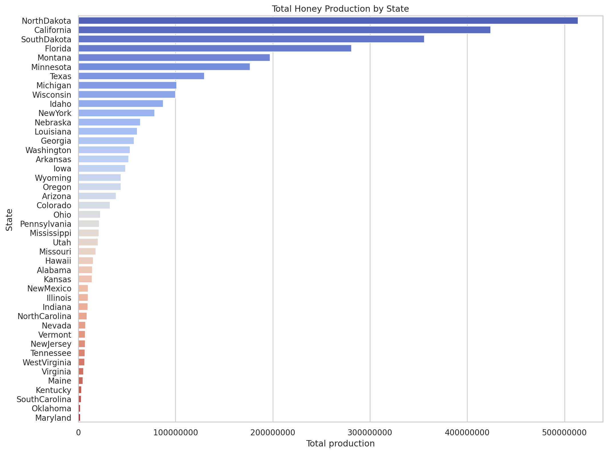
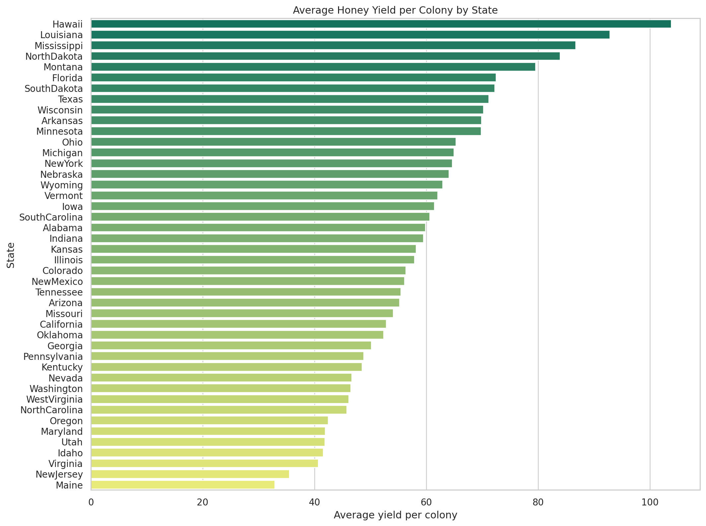
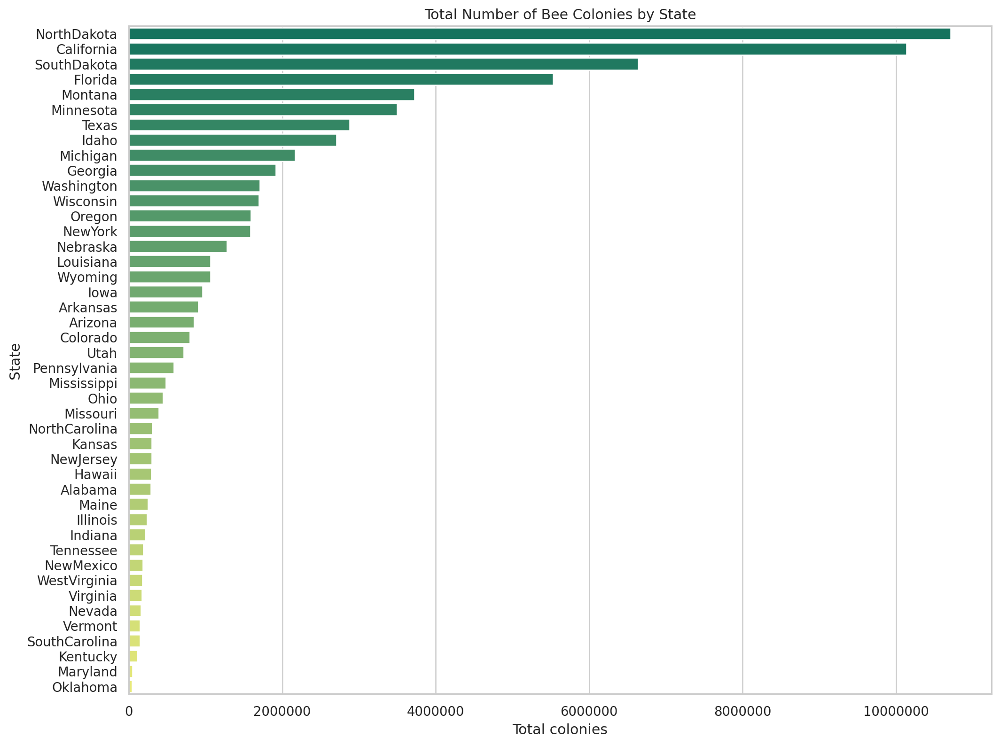
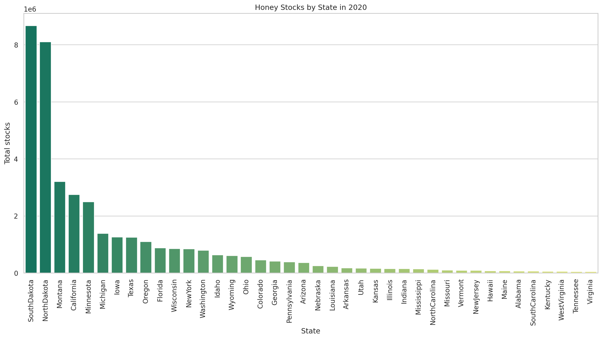
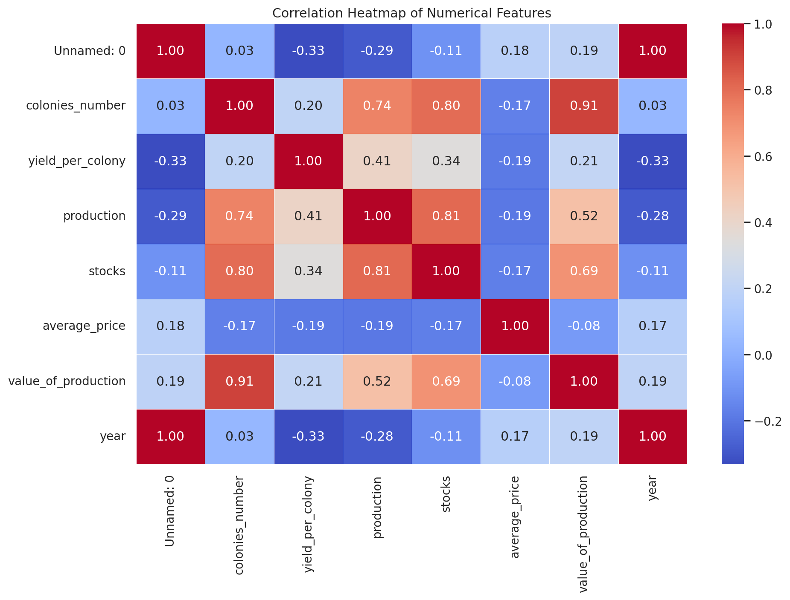

<div align="center">

# 🍯 US Honey Dataset | Visualisation Practice

**Exploratory Data Analysis and Statistical Visualisation with Python**

[](https://www.python.org/)
[](https://pandas.pydata.org/)
[](https://matplotlib.org/)
[](https://seaborn.pydata.org/)

*A hands-on Python visualisation practice project using the US honey production dataset.*

</div>

---

## 🧭 Quick navigation

| Section | What you'll find |
|---|---|
| [About](#-about-the-project) | Project overview |
| [Dataset](#-dataset) | Dataset columns and structure |
| [Visualisations](#-visualisations) | All five charts |
| [Code](#-analysis-code) | Python code for each analysis |
| [Run locally](#-run-this-project) | Setup instructions |
| [Folder structure](#-repository-structure) | Project files |

---

## 📌 About the project

This repository contains my Python visualisation practice based on the **US Honey Dataset**. The notebook explores honey production, bee colonies, yield per colony, honey stocks and relationships between numerical features.

The project uses **Pandas** for data manipulation and **Matplotlib** and **Seaborn** for charts.

## 🗂️ Dataset

- **Rows:** 1,115
- **Columns:** 9
- **File:** `data/US_honey_dataset.csv`

| Column | Description |
|---|---|
| `Unnamed: 0` | Index column |
| `state` | State column of America |
| `colonies_number` | Number of bee colonies |
| `yield_per_colony` | Average honey production by one colony |
| `production` | Total honey production |
| `stocks` | Honey remaining in storage |
| `average_price` | Average selling price |
| `value_of_production` | Total revenue generated |
| `year` | Year of observation |

---

## 📊 Visualisations

Click a chart to open the full-size image.

<details open>
<summary><strong>1. Honey production by state</strong></summary>

Which state has produced the highest amount of honey throughout all available years?

<p align="center">
  <a href="visualizations/honey-production-by-state.png">
    
  </a>
</p>

**Method:** Group by `state`, sum `production`, then sort in descending order.

</details>

<details>
<summary><strong>2. Average yield per colony by state</strong></summary>

Which state has the highest and lowest average yield per colony throughout all years?

<p align="center">
  <a href="visualizations/average-yield-per-colony.png">
    
  </a>
</p>

**Method:** Group by `state`, calculate the mean of `yield_per_colony`, then sort in descending order.

</details>

<details>
<summary><strong>3. Total number of colonies by state</strong></summary>

Which state has the highest and lowest number of bee colonies?

<p align="center">
  <a href="visualizations/colonies-by-state.png">
    
  </a>
</p>

**Method:** Group by `state`, sum `colonies_number`, then sort in descending order.

</details>

<details>
<summary><strong>4. Honey stocks by state in 2020</strong></summary>

Which state had the highest honey stock in 2020?

<p align="center">
  <a href="visualizations/honey-stocks-2020.png">
    
  </a>
</p>

**Method:** Filter the dataset for `year == 2020`, group by `state`, sum `stocks`, then sort in descending order.

</details>

<details>
<summary><strong>5. Correlation heatmap</strong></summary>

Visualise the correlation between the numerical columns in the US honey dataset.

<p align="center">
  <a href="visualizations/correlation-heatmap.png">
    
  </a>
</p>

**Method:** Use `df.corr(numeric_only=True)` and plot the result with Seaborn's `heatmap()`.

</details>

---

## 💻 Analysis code

The complete runnable script is available in [`analysis.py`](analysis.py), and the original working notebook is included as [`US_honey_dataset.ipynb`](US_honey_dataset.ipynb).

<details>
<summary><strong>1. Honey production by state</strong></summary>

```python
High_prof_state = (
    df.groupby("state")["production"]
      .sum()
      .sort_values(ascending=False)
      .reset_index()
)

plt.figure(figsize=(12, 8))
sns.barplot(data=High_prof_state, x="production", y="state",
            hue="state", palette="coolwarm", legend=False)
plt.title("Honey Production by State")
plt.xlabel("Production")
plt.ylabel("State")
plt.grid(alpha=0.3)
plt.tight_layout()
plt.show()
```
</details>

<details>
<summary><strong>2. Average yield per colony</strong></summary>

```python
yield_per_col = (
    df.groupby("state")["yield_per_colony"]
      .mean()
      .sort_values(ascending=False)
      .reset_index()
)

plt.figure(figsize=(12, 8))
sns.barplot(data=yield_per_col, x="yield_per_colony", y="state",
            hue="state", palette="summer", legend=False)
plt.title("Average Yield/Colony by State")
plt.xlabel("Average yield per colony")
plt.ylabel("State")
plt.tight_layout()
plt.show()
```
</details>

<details>
<summary><strong>3. Total colonies by state</strong></summary>

```python
grouped_col = (
    df.groupby("state")["colonies_number"]
      .sum()
      .sort_values(ascending=False)
      .reset_index()
)

plt.figure(figsize=(12, 8))
sns.barplot(data=grouped_col, x="colonies_number", y="state",
            hue="state", palette="summer", legend=False)
plt.title("Total Number of Colonies by State")
plt.xlabel("Number of Colonies")
plt.ylabel("State")
plt.grid(alpha=0.4)
plt.tight_layout()
plt.show()
```
</details>

<details>
<summary><strong>4. Honey stocks in 2020</strong></summary>

```python
df_2020 = df[df["year"] == 2020]

Gd = (
    df_2020.groupby("state")["stocks"]
           .sum()
           .sort_values(ascending=False)
           .reset_index()
)

plt.figure(figsize=(12, 8))
sns.barplot(data=Gd, x="state", y="stocks",
            hue="state", palette="summer", legend=False)
plt.title("Stock by State in 2020 Year")
plt.xticks(rotation=90)
plt.tight_layout()
plt.show()
```
</details>

<details>
<summary><strong>5. Correlation heatmap</strong></summary>

```python
corr = df.corr(numeric_only=True)

plt.figure(figsize=(10, 6))
sns.heatmap(corr, annot=True, cmap="coolwarm", fmt=".2f")
plt.title("Heatmap")
plt.tight_layout()
plt.show()
```
</details>

---

## 🚀 Run this project

1. Clone the repository:

   ```bash
   git clone https://github.com/Shubhamkeshri433/US-Honey-Visualisation-Practice.git
   cd US-Honey-Visualisation-Practice
   ```

2. Install the required libraries:

   ```bash
   pip install -r requirements.txt
   ```

3. Run the analysis:

   ```bash
   python analysis.py
   ```

4. Or open `US_honey_dataset.ipynb` in Jupyter Notebook and run the cells.

## 📦 Repository structure

```text
US-Honey-Visualisation-Practice/
│
├── data/
│   └── US_honey_dataset.csv
│
├── visualizations/
│   ├── honey-production-by-state.png
│   ├── average-yield-per-colony.png
│   ├── colonies-by-state.png
│   ├── honey-stocks-2020.png
│   └── correlation-heatmap.png
│
├── analysis.py
├── US_honey_dataset.ipynb
├── requirements.txt
├── .gitignore
└── README.md
```

## 🛠️ Tools used

- Python
- Pandas
- Matplotlib
- Seaborn
- Jupyter Notebook

---

<div align="center">

**Visualisation practice project | US Honey Dataset**

Made while learning Python, Pandas and Data Visualisation.

</div>
